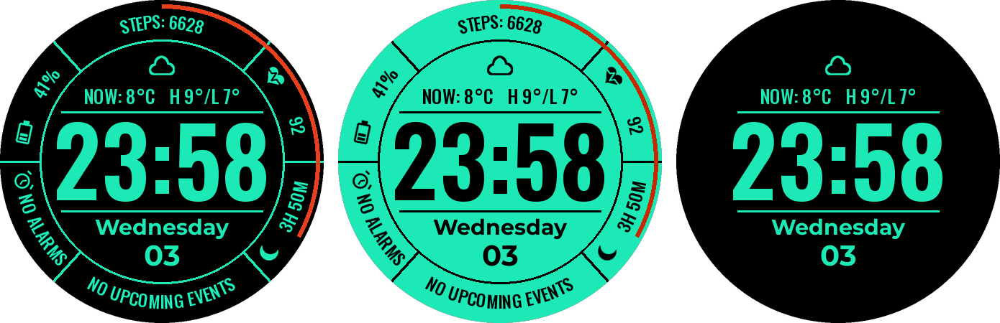
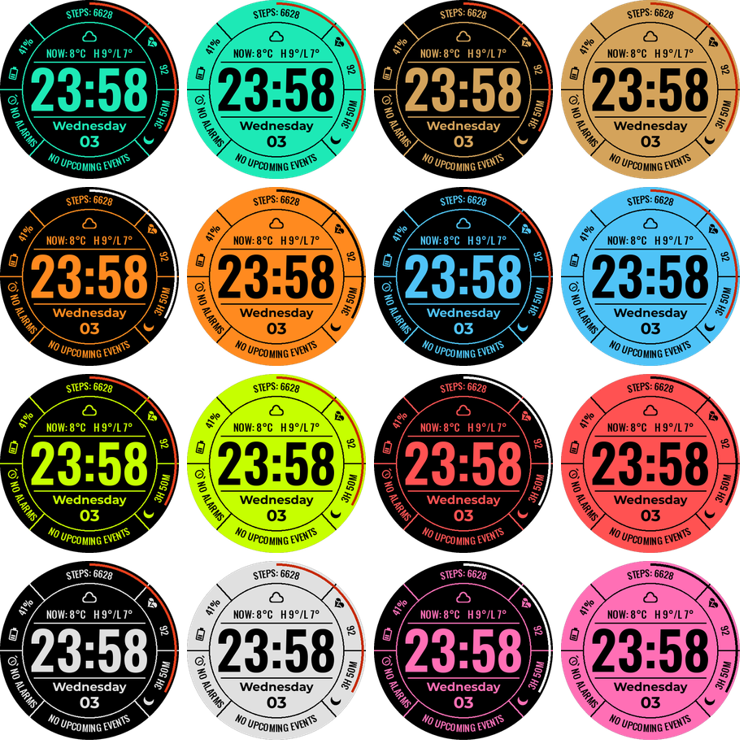

# Pulse Ring: a Wear OS watch face for the Galaxy Watch 7

A bold digital watch face with a ring of live data around the clock. It's built with Google's
**Watch Face Format (WFF) v2**, the format Wear OS 5+ watches like the Galaxy Watch 7 require.



## What's on the face

| Position | Shows | Source |
|---|---|---|
| Top ring | `STEPS: 6628` | Built-in step counter |
| Bezel arc (red) | Progress to your daily step goal, filling clockwise from 12 o'clock | Built-in `STEP_PERCENT` |
| Upper right | Heart icon and live BPM (`--` when no reading). Tap to open Heart rate | Built-in heart rate |
| Upper left | Battery icon (5 fill levels) and %. Tap to open battery status | Built-in battery |
| Lower left | **Complication slot**, e.g. Alarm (`NO ALARMS`) | Your choice |
| Lower right | **Complication slot**, e.g. Sleep (`3H 50M`) | Your choice |
| Bottom ring | **Complication slot**, Next event (`NO UPCOMING EVENTS`) | Calendar by default |
| Centre | Weather icon (16 conditions, day/night), `NOW: 8°C  H 9°/L 7°` | Built-in weather |
| Centre | Large `HH:MM` (follows the watch's 12/24-hour setting), weekday, date. Tap to open the calendar | Clock |

**Always-on display:** shows only the weather, time, weekday and date in the theme's accent colour
on black. The ring and complications are hidden to save battery.

## Themes

There are 8 accent colours, each in a **dark** style (black background, coloured text) and an
**inverted** style (coloured background, black text). That's 16 options in total. Pick one under
**Customise → Theme**. The step arc can be turned off under **Customise**.



## Build and install on a Galaxy Watch 7

1. Open this `PulseRingWatchFace` folder in **Android Studio** (a recent version with
   Android Gradle Plugin 9) and let it sync. It downloads Gradle and the SDK automatically.
   From the command line:
   ```bash
   ./gradlew :watchface:assembleDebug
   ```
   The APK is written to `watchface/build/outputs/apk/debug/watchface-debug.apk`.
2. Turn on developer mode on the watch: **Settings → About watch → Software information** →
   tap **Software version** 5 times. Then go to **Settings → Developer options** and turn on
   **ADB debugging** and **Wireless debugging**.
3. Connect over Wi-Fi (the watch and computer must be on the same network). In
   **Wireless debugging**, tap **Pair new device** and run:
   ```bash
   adb pair <ip>:<pair-port>     # enter the 6-digit code shown on the watch
   adb connect <ip>:<port>       # the IP and port shown on the Wireless debugging screen
   adb install watchface/build/outputs/apk/debug/watchface-debug.apk
   ```
4. On the watch, long-press the current watch face, swipe to the end, tap **+ Add watch face**,
   and choose **Pulse Ring**.

## Set it up like the reference

Long-press the face, tap **Customise**, then:

- **Theme:** pick a colour, e.g. *Mint*, *Mint inverted* or *Gold*.
- **Complications:** tap the lower-left slot and choose **Alarm**. Tap the lower-right slot and
  choose **Sleep** (Samsung Health). The bottom slot already shows your next calendar event.

Weather comes from the watch's own weather service. Open the **Weather** app on the watch once
and allow location access so the data appears. Until then the face shows `NO WEATHER DATA`.

## Changing the design

Don't edit `res/raw/watchface.xml` by hand. It's generated, together with the icons and the
preview images, by `tools/generate.py`. Change the layout constants or the theme list at the top
of that file and run:

```bash
pip install pillow
python3 tools/generate.py
```

To check the XML against the official schema, use Google's
[WFF validator](https://github.com/google/watchface/tree/main/third_party/wff):

```bash
java -jar wff-validator.jar 2 watchface/src/main/res/raw/watchface.xml
```

## Notes

- The images in `docs/` come from the generator's own renderer and are a close approximation.
  On the watch, fonts and curved text can sit a pixel or two differently.
- `minSdk` is 34 (Wear OS 5), because weather data requires WFF v2.
- Before you publish to Google Play, replace the debug signing config in
  `watchface/build.gradle.kts` with your own key and change the `applicationId`.

## Credits and licences

- The layout is inspired by the *MB427* style shown in the screenshots this project started from.
  All artwork, icons and code here are original. If you publish this watch face, use your own
  name and branding.
- Fonts: [Oswald](https://fonts.google.com/specimen/Oswald) and
  [Montserrat](https://fonts.google.com/specimen/Montserrat), under the SIL Open Font License 1.1
  (see `licenses/`). The fonts are subset to Latin characters and fixed at a single weight.
- The Gradle wrapper comes from Google's
  [wear-os-samples](https://github.com/android/wear-os-samples) (Apache 2.0).
